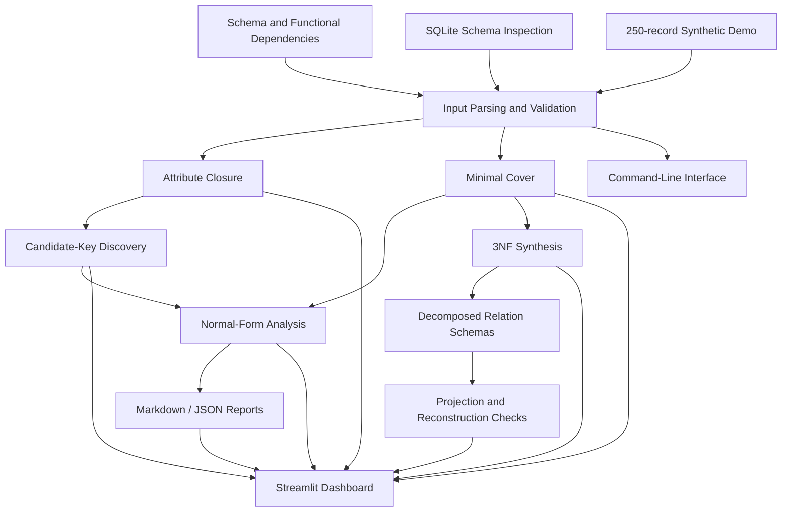
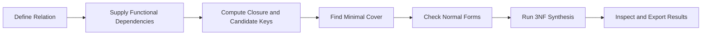

<div align="center">

# DBSchemaX

**A relational schema and functional dependency analyzer that turns database-design rules into mathematically justified keys, normalization checks, and decomposed schemas.**

[](#tech-stack)
[](#tech-stack)
[](#tech-stack)
[](#testing)
[](#mfcs-concepts)

</div>

---

## Overview

**DBSchemaX** is a Python project that applies discrete mathematics to relational database design. It helps users analyse relation schemas and functional dependencies, discover candidate keys, simplify dependency sets, inspect normal-form violations, and generate a 3NF decomposition.

The project combines a reusable mathematical core with a command-line interface, SQLite schema integration, Markdown/JSON reporting, and a Streamlit dashboard. Its **Normalization Lab** provides a reproducible 250-record college-enrollment example so users can compare a denormalized relation with the tables produced by the synthesis workflow.

> **Core idea:** provide a schema and its functional dependencies, let DBSchemaX perform the analysis, and inspect both the mathematical evidence and the proposed database design.

## Table of Contents

- [The Problem](#the-problem)
- [The Solution](#the-solution)
- [Key Features](#key-features)
- [Interactive Modules](#interactive-modules)
- [Normalization Lab](#normalization-lab)
- [MFCS Concepts](#mfcs-concepts)
- [Tech Stack](#tech-stack)
- [Architecture](#architecture)
- [Analysis Workflow](#analysis-workflow)
- [Project Structure](#project-structure)
- [Getting Started](#getting-started)
- [Using DBSchemaX](#using-dbschemax)
- [Testing](#testing)
- [Important Assumptions and Limitations](#important-assumptions-and-limitations)
- [Future Improvements](#future-improvements)

---

## The Problem

Relational database design becomes difficult when a table contains many attributes and the relationships between them are not obvious. A poorly designed relation can store the same fact repeatedly and introduce update, insertion, or deletion anomalies.

DBMS students and developers need to answer questions such as:

- Which attributes uniquely identify a row?
- Is a proposed key minimal, or does it contain unnecessary attributes?
- Which functional dependencies are redundant or can be simplified?
- Does the relation satisfy 2NF, 3NF, or BCNF under the supplied dependencies?
- If a relation needs to be decomposed, what smaller schemas should be created?
- Can the decomposed tables preserve the dependencies and reconstruct the original relation?

Doing these calculations manually can be repetitive and difficult to verify—especially as the number of attributes and dependencies grows.

## The Solution

DBSchemaX brings these tasks into one workflow:

1. **Define the relation** by specifying its attributes and functional dependencies, or inspect a supported SQLite schema.
2. **Analyse the rules** using attribute closure, candidate-key discovery, and minimal-cover algorithms.
3. **Evaluate the design** against supported normal-form rules and review the explanations for the results.
4. **Generate a decomposition** using the existing 3NF synthesis implementation.
5. **Inspect and export results** through the command-line interface, reports, or Streamlit dashboard.

The tool is designed to show more than a status label: its purpose is to connect the result to the functional dependencies and mathematical reasoning behind it.

---

## Key Features

### Relation and Functional Dependency Analysis
- Represent relation schemas and functional dependencies with immutable data models.
- Parse functional dependencies using `->` or `→` notation.
- Support an empty left-hand side where it is valid in the mathematical model, such as `∅ → A`.
- Validate attributes and dependency definitions against the supplied relation.

### Mathematical Algorithms
- **Attribute closure** — calculate the attributes implied by a starting attribute set.
- **Candidate-key discovery** — find minimal superkeys using the supplied functional dependencies.
- **Minimal cover** — simplify a dependency set using standard equivalence-preserving transformations.
- **Normalization analysis** — evaluate supported 2NF, 3NF, and BCNF conditions and report relevant violations.
- **3NF synthesis** — generate relation schemas from a minimal cover.

### Practical Tooling
- **Command-line interface** for running supported project operations.
- **SQLite integration** to inspect supported table/schema metadata without modifying the source database.
- **Markdown and JSON reports** for sharing analysis results.
- **Streamlit dashboard** with dedicated views for schema input, dependencies, keys, minimal cover, normalization, synthesis, and reports.
- **Normalization Lab** with a generated dataset, before/after comparisons, normalized table previews, and downloadable outputs.
- **Automated tests** covering mathematical logic, inputs, CLI, reporting-related integration, and UI support.

---

## Interactive Modules

| Module | Purpose | What it helps answer |
|---|---|---|
| **Overview** | Introduces the workflow and example results. | What does DBSchemaX analyse? |
| **Schema Input** | Defines a relation and its dependencies. | What are the attributes and rules? |
| **Dependency Explorer** | Examines functional dependencies and closure reasoning. | What follows from a given attribute set? |
| **Candidate Keys** | Presents candidate-key results. | Which minimal sets identify the whole relation? |
| **Minimal Cover** | Displays a simplified equivalent dependency set. | Which dependency components are unnecessary? |
| **Normalization** | Checks normal-form conditions and violations. | Which rules does the current design fail? |
| **3NF Synthesis** | Generates schemas using the synthesis algorithm. | How can the relation be organized into smaller tables? |
| **Reports** | Presents/export analysis output. | How can results be saved or shared? |
| **Normalization Lab** | Runs the guided 250-record example. | What changed in the data and why? |

---

## Normalization Lab

The Normalization Lab is intended to make normalization visible and easier to explain. Instead of analysing only a tiny example, it loads a deterministic **synthetic college-enrollment dataset containing 250 records and 11 columns**.

The demo includes student, department, course, instructor, semester, and grade information. It supplies a known set of functional dependencies, checks them against the generated records, runs the existing key and synthesis logic, and projects the source tuples into the resulting relation schemas.

### Example before-and-after comparison

| Measurement | Original relation | Normalized relations |
|---|---:|---:|
| Number of relations/tables | 1 | 6 |
| Total rows across all tables | 250 | 383 |
| Attribute-value cells | 2,750 | 1,434 |
| Reconstruction check | — | Exact tuple-set match |

The sample's attribute-value-cell count is approximately **47.9% lower** after decomposition. The total number of rows increases because details such as students, courses, and departments are stored separately from enrolments. The cell count is a simple indicator of repeated data—not a precise measurement of disk usage or file size.

### What the demo demonstrates

- **Dependency validation:** checks that the declared dependencies hold on the generated sample records.
- **Key analysis:** determines the candidate key from the supplied schema and rules.
- **Decomposition:** uses the existing 3NF synthesis implementation to derive the output relation schemas.
- **Projection and deduplication:** creates each output relation's rows from the original records and removes duplicate tuples.
- **Reconstruction verification:** checks whether joining the decomposed relations reconstructs the original tuple set.
- **Export:** allows the normalized data to be inspected and downloaded through the Lab interface.

The demo data is generated for repeatability and teaching; it is **not a real university dataset**. The example's functional dependencies are deliberately designed to hold for its generated records.

---

## MFCS Concepts

DBSchemaX connects Mathematics for Computer Science (MFCS) concepts to database-design tasks.

| Concept | Role in DBSchemaX |
|---|---|
| **Sets and subsets** | Represent attributes, attribute sets, and candidate keys. |
| **Logic and implication** | Functional dependencies express which attributes determine other attributes. |
| **Fixed-point computation** | Attribute closure repeatedly applies dependencies until no new attributes are added. |
| **Minimality** | Candidate keys must be superkeys with no unnecessary proper subset; minimal covers remove redundant dependency components. |
| **Algorithmic search** | Candidate-key discovery examines possible attribute sets; the search can grow exponentially with the number of attributes. |
| **Equivalence-preserving transformations** | Minimal-cover and synthesis steps use dependency rules to simplify and organize the schema. |
| **Correctness checks** | Dependency validation and tuple reconstruction test important properties of the example decomposition. |

### Key terminology

- **Functional dependency** `X → Y`: within the intended relation, rows agreeing on attribute set `X` must also agree on attribute set `Y`.
- **Attribute closure** `X⁺`: all attributes implied by `X` under a given set of functional dependencies.
- **Superkey**: an attribute set whose closure contains every attribute in the relation.
- **Candidate key**: a minimal superkey.
- **Minimal cover**: an equivalent dependency set simplified according to the project's minimal-cover algorithm.
- **Normalization**: organizing relation schemas to reduce problematic redundancy and avoid data anomalies while respecting the applicable dependency rules.

---

## Tech Stack

| Layer | Technology | Purpose |
|---|---|---|
| **Language** | Python 3.10+ | Mathematical logic, models, CLI and integration code |
| **UI** | Streamlit | Interactive analysis dashboard and Normalization Lab |
| **Database integration** | SQLite | Read supported schema and table metadata |
| **Testing** | pytest | Unit and integration tests |
| **Packaging** | setuptools with `pyproject.toml` | Editable installation and CLI entry point |
| **Report formats** | Markdown, JSON | Save and share analysis output |

The core mathematical algorithms are kept separate from the user interface and SQLite integration so they can be tested independently.

---

## Architecture



### Design principles

- **Separate concerns:** mathematical algorithms do not depend on Streamlit UI behavior.
- **Make assumptions visible:** dependency and atomicity information must be supplied or confirmed where it cannot safely be inferred.
- **Prefer verifiable output:** display results with supporting calculations or checks where implemented.
- **Preserve source data:** SQLite integration is for inspection; the Normalization Lab operates on its own synthetic demo data.

---

## Analysis Workflow



1. Define the relation's attributes and specify the functional dependencies that describe the intended data model.
2. Use closure and candidate-key analysis to identify which attribute sets determine the complete relation.
3. Simplify the dependency set with the minimal-cover algorithm.
4. Review normal-form results and the rules behind any reported violations.
5. Generate a 3NF decomposition where applicable, then inspect the resulting relation schemas and report output.

---

## Project Structure

```text
DBSchemaX/
├── pyproject.toml
├── README.md
├── src/
│   └── dbschemax/
│       ├── __init__.py
│       ├── __main__.py
│       ├── models.py
│       ├── parser.py
│       ├── closure.py
│       ├── candidate_keys.py
│       ├── minimal_cover.py
│       ├── normalization.py
│       ├── synthesis.py
│       ├── sqlite_integration.py
│       ├── reporting.py
│       ├── cli.py
│       ├── explain.py
│       ├── inputs.py
│       ├── ui_support.py
│       ├── demo_data.py
│       ├── normalization_lab.py
│       └── streamlit_app.py
└── tests/
    ├── test_parser.py
    ├── test_closure.py
    ├── test_candidate_keys.py
    ├── test_minimal_cover.py
    ├── test_normalization.py
    ├── test_synthesis.py
    ├── test_sqlite_integration.py
    ├── test_reporting.py
    ├── test_cli.py
    ├── test_explain.py
    ├── test_inputs.py
    ├── test_ui_support.py
    ├── test_normalization_lab.py
    └── test_normalization_lab_app.py
```

*The tree shows the main modules and representative test files; filenames may evolve as the project changes.*

---

## Getting Started

### Prerequisites

- Python 3.10 or newer
- PowerShell on Windows, or a terminal on macOS/Linux
- Git (optional, for cloning the repository)

### 1. Create and activate a virtual environment

**Windows PowerShell**

```powershell
python -m venv .venv
.\.venv\Scripts\Activate.ps1
```

If PowerShell blocks activation for the current session, use:

```powershell
Set-ExecutionPolicy -Scope Process -ExecutionPolicy RemoteSigned
.\.venv\Scripts\Activate.ps1
```

### 2. Install DBSchemaX with UI and testing dependencies

From the project root—the directory containing `pyproject.toml`—run:

```powershell
python -m pip install --upgrade pip
python -m pip install -e ".[ui,test]"
```

This installs the project in editable mode, Streamlit for the dashboard, and pytest for tests.

### 3. Run the tests

```powershell
$env:PYTHONPATH = "src"
python -m pytest
```

### 4. Launch the Streamlit dashboard

```powershell
python -m streamlit run src/dbschemax/streamlit_app.py
```

Open the local URL printed in the terminal by Streamlit.

---

## Using DBSchemaX

### Launch the command-line interface

Show available commands and options:

```powershell
python -m dbschemax --help
```

If the package's console script is available in the active environment, you can also use:

```powershell
dbschemax --help
```

Use the help output to see the supported CLI arguments for your installed version.

### Try the Normalization Lab

1. Launch the Streamlit dashboard.
2. Open **Normalization Lab**.
3. Load the **250-record synthetic demo**.
4. Inspect the original relation, attributes and functional dependencies.
5. Review the candidate key and normal-form analysis.
6. Inspect each synthesized relation and its rows.
7. Review the before/after cell counts and reconstruction check.
8. Download the resulting tables or reports from the available export controls.

### Bring your own schema

For a custom analysis, provide the relation's attributes and functional dependencies. These dependencies are part of the logical data model: a few sample records cannot establish every dependency that must hold for all valid future records.

For 1NF analysis, atomicity information may also be needed because whether a value is atomic depends on the intended meaning and domain of the attribute.

---

## Testing

DBSchemaX uses `pytest` to test the core algorithms and supporting workflows. The suite covers areas such as parsing, closure, candidate-key discovery, minimal cover, normalization, synthesis, SQLite integration, reports, CLI inputs and dashboard helpers.

Run the complete suite from the project root:

```powershell
$env:PYTHONPATH = "src"
python -m pytest
```

For a more verbose test listing:

```powershell
python -m pytest -v
```

Always use the results from your current working tree as the authoritative test status; test counts can change as the project evolves.

---

## Important Assumptions and Limitations

- **Functional dependencies are model inputs.** DBSchemaX analyses the rules supplied by the user; it does not prove that they describe every valid real-world record simply by examining a small sample.
- **Atomicity may require user input.** 1NF depends on the semantic definition of each attribute, so it cannot always be inferred automatically from a column name or a few values.
- **Candidate-key search can be expensive.** Exhaustive search may scale exponentially as relation attributes increase.
- **Normalization does not necessarily reduce row count or disk usage.** It separates facts into relations; total rows can increase even while repeated attribute values decrease.
- **The Lab dataset is synthetic.** It is designed to be reproducible and to satisfy its declared dependencies, not to represent real student records.
- **3NF synthesis is dependency-driven.** The generated schemas depend on the validity and completeness of the supplied dependency set.

---

## Future Improvements

Potential next steps include a more guided learning path for first-time users, richer dependency visualizations, clearer key/foreign-key relationship diagrams, additional test fixtures, and improved export options. These are ideas for future work, not claims about current functionality.

---

<div align="center">

**DBSchemaX**  
*Making relational database design more explainable through mathematics.*

</div>
